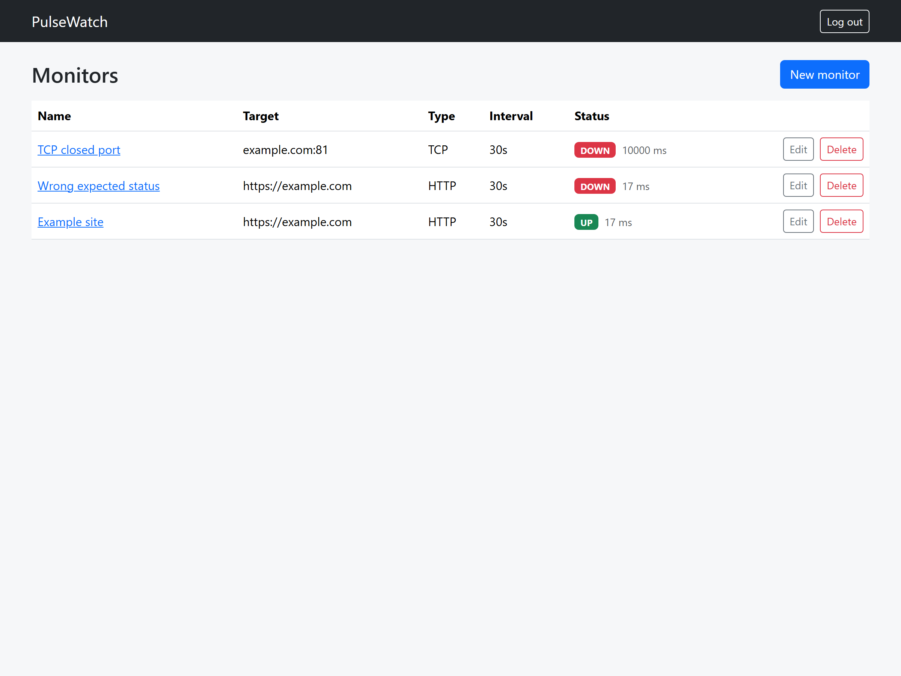
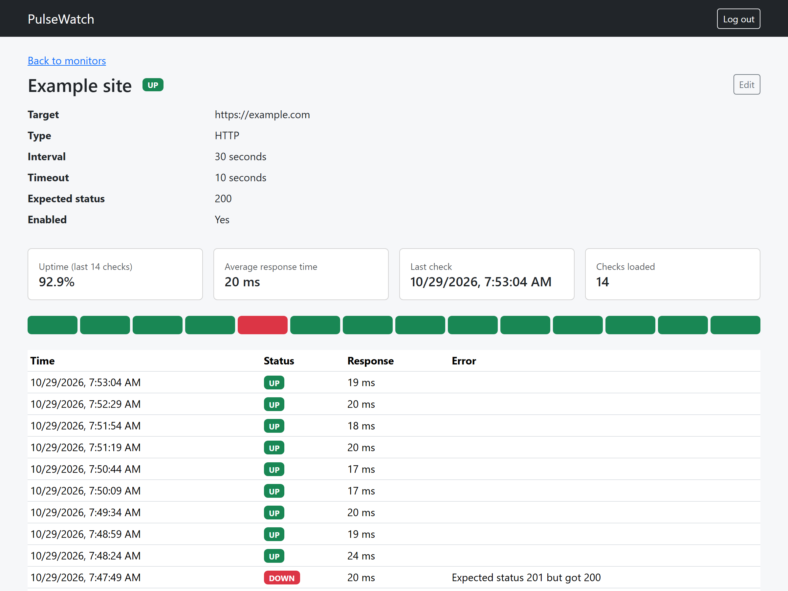
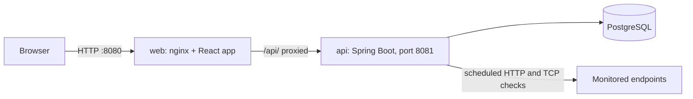

# PulseWatch

[](https://github.com/ababitsbence/pulsewatch-uptime-monitor/actions/workflows/ci.yml)

A self-hosted uptime and health monitoring platform. Register endpoints, get scheduled health checks, and see status history in a dashboard, with Prometheus metrics and Kubernetes manifests included.

> **Status:** work in progress. See the roadmap below.

## About The Project

PulseWatch lets a user register HTTP and TCP endpoints, checks them on a schedule, and stores the results so uptime and response times can be reviewed over time. It is built as a portfolio project to demonstrate a Java backend together with the DevOps tooling around it: containerization, CI/CD, observability, and Kubernetes.

### Features

- [x] JWT authentication
- [x] Monitor management with per-user isolation (HTTP and TCP, configurable interval and timeout)
- [x] Scheduled health checks with stored result history
- [x] SSRF protection for user-supplied URLs
- [x] React dashboard: monitor list with live status, create, edit, delete and check history
- [x] One-command Docker Compose stack (API, web app, PostgreSQL)
- [x] CI pipeline: tests, image build and Compose smoke test
- [ ] Image publishing (GHCR) and vulnerability scan
- [ ] Prometheus metrics and a Grafana dashboard
- [ ] Kubernetes deployment, verified by a smoke test on `kind` in CI

## Screenshots

| Monitors | Monitor detail |
|---|---|
|  |  |

## Built With

- **Backend:** Java 25, Spring Boot 4, Spring Security (JWT), Spring Data JPA, Flyway
- **Database:** PostgreSQL
- **Frontend:** React (Vite), Bootstrap, React Router
- **Observability:** Micrometer, Prometheus, Grafana *(planned)*
- **CI:** GitHub Actions
- **Infrastructure:** Docker, Docker Compose, nginx, Kubernetes *(planned)*
- **Testing:** JUnit 5, Mockito, Testcontainers, Vitest, React Testing Library

## Prerequisites

- [Docker](https://www.docker.com/), running
- JDK 25, only needed to run the backend tests or the API outside Docker (Maven is not needed, the wrapper is included)
- Node 22 or newer, only needed for frontend development

## How to Run

### 1. Clone the repository

```
git clone https://github.com/ababitsbence/pulsewatch-uptime-monitor.git
cd pulsewatch-uptime-monitor
```

### 2. Start the stack

```
# Windows PowerShell
.\run.ps1

# macOS / Linux
./run.sh
```

On first run the script creates a `.env` file with a random database password and JWT signing secret (see `.env.example`), builds the images and starts PostgreSQL, the API and the web app. It waits until the web app responds.

If PowerShell blocks the script, run `powershell -ExecutionPolicy Bypass -File .\run.ps1`. If port 8080 or 8081 is already in use, change the left-hand number of the port mapping in `compose.yaml`.

### 3. Open the app

Open **http://localhost:8080**, register an account and create your first monitor.

To check the API directly:

```
curl.exe http://localhost:8081/actuator/health
```

On macOS/Linux, use `curl` instead of `curl.exe`.

Expected response: `{"groups":["liveness","readiness"],"status":"UP"}`

### 4. Stop

```
docker compose down       # stop, keep the data
docker compose down -v    # stop and delete the database
```

The database is not published to the host. The web app is on port 8080 and the API on port 8081.

## Running Tests

```
# Backend (Docker must be running, the tests start a PostgreSQL container with Testcontainers)
cd backend
./mvnw test        # Windows PowerShell: .\mvnw.cmd test

# Frontend
cd frontend
npm install
npm test
```

## Frontend Development

```
cd frontend
npm install
npm run dev      # http://localhost:5173, proxies /api to the API on port 8081
npm test
npm run lint
npm run build
```

Start the stack with `run.ps1` / `run.sh` first, so the dev server has an API to talk to. In the Compose stack, nginx serves the built app and proxies `/api/` to the API, so the browser only ever talks to one origin and no CORS configuration is needed.

## API

| Method | Path | Auth | Description |
|---|---|---|---|
| POST | `/api/auth/register` | none | Create an account (`email`, `password` of 8-72 characters) |
| POST | `/api/auth/login` | none | Returns a JWT bearer token |
| GET | `/api/users/me` | Bearer token | Returns the current user |
| GET | `/api/monitors` | Bearer token | List your monitors, newest first |
| POST | `/api/monitors` | Bearer token | Create a monitor |
| GET | `/api/monitors/{id}` | Bearer token | Get one of your monitors |
| PUT | `/api/monitors/{id}` | Bearer token | Replace a monitor (omitting `enabled` sets it to `true`) |
| DELETE | `/api/monitors/{id}` | Bearer token | Delete a monitor |
| GET | `/api/monitors/{id}/results` | Bearer token | Check history, newest first (`?limit=` 1 to 200, default 50) |

Errors use one JSON format: `{"status": 401, "message": "...", "details": {}}`.

Example (macOS / Linux):

```
curl -X POST http://localhost:8081/api/auth/register -H "Content-Type: application/json" -d '{"email":"me@example.com","password":"supersecret"}'
curl -X POST http://localhost:8081/api/auth/login -H "Content-Type: application/json" -d '{"email":"me@example.com","password":"supersecret"}'
curl http://localhost:8081/api/users/me -H "Authorization: Bearer <accessToken>"
```

Windows PowerShell:

```
$body = @{ email = "me@example.com"; password = "supersecret" } | ConvertTo-Json
Invoke-RestMethod -Method Post -Uri http://localhost:8081/api/auth/register -ContentType "application/json" -Body $body
$login = Invoke-RestMethod -Method Post -Uri http://localhost:8081/api/auth/login -ContentType "application/json" -Body $body
Invoke-RestMethod -Uri http://localhost:8081/api/users/me -Headers @{ Authorization = "Bearer $($login.accessToken)" }
```

Create and list monitors (macOS / Linux):

```
curl -X POST http://localhost:8081/api/monitors -H "Authorization: Bearer <accessToken>" -H "Content-Type: application/json" -d '{"name":"Example","target":"https://example.com","type":"HTTP","intervalSeconds":60,"timeoutSeconds":10}'
curl http://localhost:8081/api/monitors -H "Authorization: Bearer <accessToken>"
```

### Monitor fields and validation

| Field | Rule |
|---|---|
| `name` | required, up to 100 characters |
| `type` | `HTTP` or `TCP` |
| `target` | HTTP: an `http`/`https` URL with a host and no credentials. TCP: `host:port`, port 1 to 65535 |
| `intervalSeconds` | 30 to 86400 |
| `timeoutSeconds` | 1 to 60, and smaller than `intervalSeconds` |
| `expectedStatus` | HTTP only, 100 to 599, defaults to 200 |
| `enabled` | optional, defaults to `true` |

Example request body:

```
{"name":"Example","target":"https://example.com","type":"HTTP","intervalSeconds":60,"timeoutSeconds":10}
```

### Health checks

A background scheduler looks for due monitors every 5 seconds and runs their checks concurrently (virtual threads, at most 50 at a time). A monitor is due when it has no result newer than its interval, so a new monitor is checked within a few seconds.

- **HTTP:** a `GET` request; the check is UP if the status equals `expectedStatus` (default 200). Redirects are not followed, and the response body is never read.
- **TCP:** UP if a connection to `host:port` succeeds within the timeout.
- Every outcome is stored with its time, status (`UP`/`DOWN`), response time and, for failures, a short error message.

Results example (macOS / Linux):

```
curl "http://localhost:8081/api/monitors/<id>/results?limit=10" -H "Authorization: Bearer <accessToken>"
```

The scheduler keeps its "running now" state in memory, so run a single instance of the API.

## Security Notes

- Passwords are hashed with BCrypt and never returned by the API.
- Login returns the same error for an unknown email and a wrong password, and does the same hashing work for both, to reduce what response time can reveal.
- The JWT signing secret comes from the environment, with no default value.
- Tokens are signed with HS256 and expire after one hour.
- The web app keeps the token in `sessionStorage`, so it is cleared when the tab closes. Scripts on the page can read it, so the nginx config sends a strict Content-Security-Policy (scripts only from the app's own origin) together with other security headers. An httpOnly cookie would be the stronger alternative.
- Monitors are scoped to the logged-in user in every query. Another user's monitor returns 404, the same as one that does not exist, so ids cannot be probed.
- The database enforces the same limits as the API (allowed types, minimum interval, timeout smaller than interval) as a second line of defence.
- SSRF protection: monitor targets that resolve to loopback, private, link-local (including the cloud metadata address), carrier-grade NAT, multicast or other reserved addresses are rejected when the monitor is saved, and checked again before every check, because DNS answers can change later. Error messages never include the resolved address. Set `APP_SSRF_ALLOW_PRIVATE_TARGETS=true` to monitor internal services on a private network.
- Known gap: the HTTP client resolves the name once more when it connects, so a very fast DNS change between the guard's lookup and the connection could still get through (redirects are disabled, which limits the impact). Pinning the checked address is tracked as an issue.
- Not implemented yet: rate limiting on login and refresh tokens.

## Architecture



The browser only talks to nginx. nginx serves the built React app and forwards `/api/` to the Spring Boot API, which stores users, monitors and check results in PostgreSQL and runs the scheduled checks against the monitored endpoints.

## Project Structure

```
pulsewatch-uptime-monitor/
├── .github/            CI workflow (GitHub Actions) and Dependabot config
├── backend/            Spring Boot API (Dockerfile, Maven wrapper, tests)
├── frontend/           React dashboard (Vite, nginx image)
├── deploy/             Prometheus/Grafana config, Kubernetes manifests (planned)
├── docs/               Screenshots
├── .env.example        Template for the .env file
├── compose.yaml        API, web app and PostgreSQL stack
├── run.ps1             Start the stack (Windows)
├── run.sh              Start the stack (macOS / Linux)
└── README.md
```

## Roadmap

- [x] Project skeleton and Docker image
- [x] JWT authentication
- [x] Monitor management API
- [x] Health check engine and scheduler
- [x] SSRF protection
- [x] React dashboard
- [x] Docker Compose stack with run scripts
- [x] CI: tests, image build and Compose smoke test
- [ ] CI: image publishing (GHCR) and vulnerability scan
- [ ] Prometheus and Grafana
- [ ] Kubernetes deployment with kind smoke test

Further ideas are tracked as GitHub Issues.

## License

This project was built as a personal portfolio piece and is not licensed for production use.